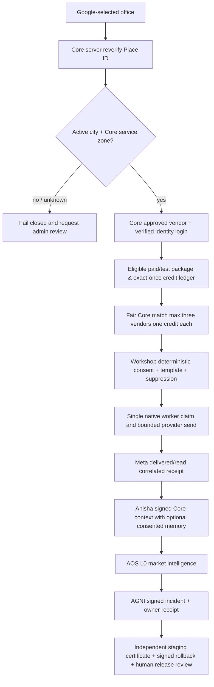

# QuickFurno VL-05 — Integrated Final Vendor Journey Acceptance and Launch Gates

**Recorded:** 13 October 2026 (IST). **Status:** IMPLEMENTED SOURCE HARNESS; **LIVE FINAL ACCEPTANCE: HOLD**. Canonical decision authority remains QuickFurno Core. This is a source/testing deliverable, not authorization to send WhatsApp messages, link identities, change wallet balances, replay jobs, activate Anisha memory, update PostGIS policies or deploy.

## System-wide acceptance flow

## VL-05 release evidence gate

Run `npm run test:vl05:acceptance` to exercise 16/16 *adversarial isolated* self-tests. `node scripts/mvp/launch/certify-vl05-final.mjs --assess <sanitized-staging-evidence.json> --core-sha <independently_verified_exact_main_sha>` evaluates a recent evidence packet without network access or changes. It requires the protocol `qf.vendor.vl05.acceptance.v1`, exact staging environment, freshness under 60 minutes, 40-hex Core source, 64-hex signed image digest, and twelve individually fresh PASS claims with reviewable GitHub/Notion links. A synthetic allowlisted canary must prove canonical vendor identity, Google+zone authority, matching cap (<=3), one credit per delivered vendor, zero duplicate/replayed credit mutation, test payment capture, real consent/erasure, genuine provider delivery, AGNI owner receipt and **classification** of any pre-existing pending jobs. Missing, stale, rejected or unreferenced proof returns `HOLD`. Even fully filled user-supplied evidence returns only `EVIDENCE_READY_FOR_HUMAN_REVIEW`, and `eligibleForProductionPromotion` is unconditionally false. The evaluator cannot cryptographically verify external provider artifacts by itself; an independent operator must compare receipts against canonical Core/Meta/Razorpay/Jarvis/AGNI sources before authorizing any release.

The corresponding self-test was inserted into the standard QF MVP 50 Quality Gate; it tests missing identity, unreadable inputs, stale source, wrong SHA, absent Cosign digest, missing Meta receipt, unresolved geography, >3 assignments, replayed credit debit, missing real sandbox capture, consent/erasure failure, unclassified old jobs and unauthorized production effects.

## Verified independent read-only database baseline

| Gate | QuickFurno production | QuickFurno staging | Acceptance |
| --- | ---: | ---: | --- |
| Vendors total / approved | 28 / 14 | 27 / 19 | Evidence only |
| Approved but no Core Auth link | 6 | 19 | HOLD for live affected cohort |
| Approved but no service zone | 14 | 19 | HOLD |
| Accepting leads with no zone | 26 | 4 | Legacy policy reconciliation needed |
| Google offices formally verified/provisional | 0 | 0 | HOLD |
| Active matching zones with null polygon | 1 | 1 | Only city-fallback **provisional**; no polygon certification |
| Vendor package orders / payments | 0 / 0 | 0 / 0 | Actual Razorpay TEST capture/replay unproven |
| Provider delivery events within seven days | 0 | 0 | Actual fresh opted-in vendor delivery unproven |
| Pending/running automation jobs | 0 | 45 | Staging queue reconciliation before worker start |
| Pending office change requests | 0 | 0 | Test positive path not yet shown with real Google provider |

**Staging queue forensic note:** All 45 open jobs are `pending`, all 45 due, with `attempt_count` maximum zero. Oldest created 9 August 2026; last modified 26 September 2026. **Do not drain/replay these automatically.** Classify by parent intent, revocation, expiration, sender/family/template/provider status, then cancel stale entries through canonical governed service with an immutable ledger; no direct SQL mutation in this phase.

**Canonical invariants (read-only SQL):** Production 71 assignment rows and 81 vendor credit log entries; staging 9 assignment rows and 6 credit logs. Both environments: zero leads with >3 vendor assignments, zero duplicate lead/vendor pairs, zero negative wallet balances, zero negative pre/post credit-ledger balances. This is useful historical evidence, **not proof of latest provider/settlement E2E**.

**AOS/notifications:** Core production `aos_runs` last 16 September 2026, only one historical row. Last `communication_delivery_events` row 27 September 2026 (48 historical events). Current Jarvis AOS SHADOW scheduler, fresh signed market source and owner-visible AGNI incident must be proven separately, not inferred from stale Core rows. Six provider template mappings and one active provider policy cannot establish real Meta delivered/read.

## Operator-only external/production gates

1. Place server-only `GOOGLE_MAPS_PLACES_SERVER_KEY` in restricted staging server environment. Verify actual Places New Details city, lat/lng, Core active service zone. Build/admin signed zone polygon when required; do not silently elevate `provisional` to `verified`.
2. Create a genuine synthetic staging vendor identity with GoTrue and recorded owner consent; verify one office-change request, Google Details and admin approval, dashboard ownership/rejection of cross-vendor ID. Never adopt shared real production email identities.
3. Execute Razorpay TEST order, *captured* server-side verification, webhook replay and exact-once wallet/ledger proof for the synthetic vendor. Check package validity. Do not send live money.
4. Verify one allowlisted opted-in Meta vendor template and delivered/read receipt with exact correlation. Test consent denied, duplicate callback, wrong template variables, UNKNOWN reply, provider retries and quiet hours. No blind resend of legacy jobs.
5. Exercise Anisha signed Core context, role/human takeover, browser unchecked preference consent, independent revocation/purge/ACK, replay and cross-vendor memory isolation. Do not enable production long-term memory until privacy approval and real evidence.
6. Verify fresh AOS SHADOW 15-minute run with source freshness and no effect; AGNI signed incident, correctly degraded UNKNOWN condition and owner-device/Telegram receipt. Do not let AGNI mutate Core business state.
7. Owner reviews the **new** exact signed digest and rollback artifact plus green CI and an independently checked staging evidence packet; production canary is limited to explicitly allowlisted consented accounts. Distinct owner authorization is required for rollback/promote. Stop/fail closed on missing metrics, location, ledger, provider or consent evidence.

**Source green is not launch green.** The user asked to complete VL-05, so the truthful exit is: source certification can be delivered now; real external provider, identity remediation, staging canary and production rollout remain `HOLD` until their objective acceptance facts exist. Canonical working memory: https://app.notion.com/p/3f7751ba167c810ba80fe0caf0180b29
